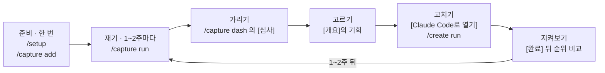

# seo-miner

내 사이트가 **구글 검색과 AI 답변에서 어디쯤인지 재고**, 그 숫자에서 **손댈 것을 뽑아**,
**실제 페이지 수정까지 잇는** 도구입니다. Claude Code 플러그인으로 이 PC 에서 쓰거나,
설치 없이 웹에서 씁니다.

측정은 스크립트가, 판단은 Claude 가, 기억은 SQLite(`brain.db`)가 맡습니다. 한 바퀴 돌
때마다 자료가 쌓여 다음 바퀴가 쉬워집니다.

## 이런 걸 답해 줍니다

- 조금만 밀면 1페이지인 검색어가 뭐고, **1페이지까지 몇 칸 남았나**
- 노출은 나오는데 **클릭이 0인 검색어**는 어디고, 제목 문제인가 경쟁 문제인가
- 애초에 **색인이 안 된 페이지**는 어디고, robots·크롤 실패·canonical 중 뭐 때문인가
- 같은 검색어인데 **모바일에서만 순위가 낮은** 건 어디인가
- ChatGPT·Perplexity·Gemini 가 이 주제에서 **누구를 인용하고 나는 왜 빠졌나**
- 검색어가 **어느 나라 구글에서** 보이고, 나라마다 몇 위인가
- 그래서 **다음에 뭘 하면 되나** — 고칠 페이지와 근거를 붙인 요청문으로

## 빠른 시작

Claude Code 채팅에 네 줄이면 됩니다.

```
/plugin marketplace add seanjr2847/seo-miner
/plugin install seo-miner@seo-miner
/reload-plugins
/setup
```

`/reload-plugins` 는 방금 깐 플러그인을 지금 세션에 바로 붙입니다(Claude Code 를 껐다 켜도 같습니다).

나머지는 `/setup` 이 하나씩 묻고 대신 해 줍니다 — 파이썬 부품 설치, 쓰는 방식 고르기,
사이트 등록, 구글 로그인, (원하면) 유료 키. 끝나면:

```
/capture run <사이트>    # 수집·분석 전 단계를 한 번에
/capture dash <사이트>   # 대시보드
```

설치 없이 쓰려면 웹: <https://seo-miner-production.up.railway.app> — 구글 로그인만 하면 됩니다.

## 목차

- [빠른 시작](#빠른-시작) · [두 가지 쓰는 법](#두-가지-쓰는-법)
- [설치](#설치) — [먼저 있어야 하는 것](#먼저-있어야-하는-것) ·
  [어디에 깔지](#어디에-깔지--설치-범위) · [/setup 이 해 주는 것](#setup-이-해-주는-것) ·
  [유료 키](#선택-유료-키) · [업데이트](#업데이트) · [지우기](#지우기) · [잘 안 될 때](#잘-안-될-때)
- [한 바퀴](#한-바퀴) · [명령](#명령) · [데이터가 사는 곳](#데이터가-사는-곳)
- [마케팅 스킬 연계](#마케팅-스킬-연계) · [설계 원칙](#설계-원칙) · [한계](#한계) · [개발](#개발)
- 더 자세히: [사용 안내 — 그림·화면별 행동](docs/guide.md) · [화면별 문서](docs/screens/)

## 두 가지 쓰는 법

| | 웹 | Claude Code 플러그인 |
|---|---|---|
| 시작 | <https://seo-miner-production.up.railway.app> 에서 구글 로그인 | [빠른 시작](#빠른-시작) |
| 측정 | 서버가 **주기적으로 알아서** 잽니다 | `/capture run` 을 칠 때 잽니다 |
| 유료 키 | 서버가 댑니다 | 필요한 것만 직접 넣습니다(없어도 됩니다) |
| 고치기 | [요청문 복사] → 쓰는 개발 도구에 붙여 넣기 | [Claude Code로 열기] → 리포에서 바로 고치고 PR |
| 자료 | 서버 계정 | 이 PC 의 `~/.capture/` |

둘을 같이 써도 됩니다. 플러그인에서 등록한 사이트는 대시보드 **[설정] → 웹에서 이어 하기**로
웹에 넘길 수 있습니다(설정만 넘어가고 측정은 웹이 처음부터 다시 잽니다 —
[자세히](docs/guide.md#웹에서-이어-하기)). 웹을 먼저 쓰고 있었다면 `/setup` 이 처음에 묻고
그 계정에 이어 붙입니다.

## 설치

**사용자가 직접 하는 것은 [빠른 시작](#빠른-시작)의 명령 몇 줄뿐**입니다. 아래는 그 세 줄의
갈래(터미널에서 · 범위 고르기 · 내려받은 폴더로)와, `/setup` 이 대신 해 주는 일을 손으로
하고 싶을 때의 명령입니다.

### 먼저 있어야 하는 것

| 무엇 | 왜 | 확인 |
|---|---|---|
| Claude Code (터미널·데스크톱·IDE 어느 것이든) | 플러그인이 여기서 돕니다 | `claude --version` |
| Python 3.11 이상 | 측정 스크립트 | `python --version` (Windows 는 `py --version`) |
| git | `/create` 가 브랜치·커밋을 만듭니다 | `git --version` |
| (선택) GitHub CLI `gh` | `/create` 의 PR 생성·머지 확인 | `gh auth status` |

> **Windows:** 명령 창의 `python` 이 Microsoft Store 로 넘어가는 가짜 실행 파일일 때가
> 있습니다. `python --version` 이 버전을 안 찍으면 python.org 설치본을 쓰세요.

### 어디에 깔지 — 설치 범위

빠른 시작의 `/plugin install` 은 뜨는 화면에서 범위를 고릅니다. 터미널에서는 범위를 붙여 칩니다:

| 범위 | 언제 | 터미널 명령 |
|---|---|---|
| **user** (기본) | 이 PC 의 모든 폴더에서 `/capture` 를 쓴다 | `claude plugin install seo-miner@seo-miner` |
| **project** | 사이트 리포 하나에서만, 팀과 같이 쓴다 — 그 리포의 `.claude/settings.json` 에 적힙니다 | 그 리포 폴더에서 `claude plugin install seo-miner@seo-miner --scope project` |
| **local** | 그 리포에서 나만 쓴다 — 커밋되지 않는 `.claude/settings.local.json` 에 적힙니다 | 그 리포 폴더에서 `claude plugin install seo-miner@seo-miner --scope local` |

마켓플레이스 등록도 터미널에서 됩니다: `claude plugin marketplace add seanjr2847/seo-miner`.
리포를 내려받아 둔 폴더로 붙이려면(개발·수정용) `seanjr2847/seo-miner` 자리에 그 폴더 경로를
씁니다. 플러그인 이름은 **`플러그인@마켓플레이스`** 꼴로 끝까지 씁니다 — 둘 다 `seo-miner` 입니다.

### /setup 이 해 주는 것

`/setup` 은 진단부터 하고, 빠진 것을 위에서부터 하나씩 확인받고 대신 합니다. 같은 일을
[설정] 화면(`/setup web`)의 버튼으로도, 아래 명령으로 손수 해도 됩니다.

| 무엇 | `/setup` 이 하는 것 | 직접 하려면 |
|---|---|---|
| 기본 파이썬 부품 | 확인받고 Claude Code 가 쓰는 파이썬에 설치 | `python -m pip install requests pyyaml` |
| 구글 부품 | 구글 로그인 전에 같이 설치 | `python -m pip install google-api-python-client google-auth-oauthlib` |
| 쓰는 방식 | 측정을 맡는 곳(이 PC / 웹) · 기회를 열 도구 · 터미널을 묻습니다 | [설정] 0단계 |
| 사이트 등록 | 4문항 인터뷰(종류·도메인·언어-지역·씨앗 검색어) | `/capture add <사이트>` 또는 [설정]의 [사이트 등록] |
| 구글 로그인 | 브라우저 로그인 창을 한 번 엽니다(무료) | `/capture gsc` 를 처음 돌리면 같은 창이 뜹니다 |
| 유료 키 | 원할 때만 — 없어도 됩니다 | [설정] → API 키 |
| 마케팅 스킬 팩 | 첫 리포트가 나온 뒤에 한 번 권합니다 | 아래 [마케팅 스킬 연계](#마케팅-스킬-연계) |

파이썬이 여럿이면 직접 친 `pip` 이 엉뚱한 파이썬에 깔릴 수 있습니다 — `/setup` 이나 [설정]의
[수집 부품 설치] 버튼은 Claude Code 가 실제로 쓰는 파이썬에 깝니다. 명령 문자열의 정본은
`skills/setup/scripts/doctor.py` 의 `CORE_PIP`·`GSC_PIP` 입니다.

`/setup doctor` 는 같은 진단을 화면 대신 채팅에 글로 냅니다. 막히면 언제든 `/setup` 으로
돌아오면 무엇이 빠졌는지와 다음 한 걸음 하나를 말해 줍니다.

구글 로그인 때 동의 화면에 **"Google에서 확인하지 않은 앱"** 경고가 뜨면 `고급` →
`...(으)로 이동`으로 지나갑니다. 경고가 싫거나 사람 없이 서버에서 돌릴 때의 갈래는
[구글 연결 자세히](#구글-연결-자세히).

### (선택) 유료 키

키는 **하나도 없어도** 측정·분석이 돕니다. 키는 새 기능이 아니라 자동화를 사는 것입니다.

| 키 | 켜지는 것 |
|---|---|
| `OPENROUTER_API_KEY` | AI 인용 확인(`/capture ai`) · 이번 달 할 일의 수정안(`/capture plays`) |
| `DATAFORSEO_LOGIN` · `DATAFORSEO_PASSWORD` | 순위 추적·경쟁사·백링크(`/capture rank`·`competitors`·`backlinks`) |
| `SERPER_API_KEY` | 순위 추적의 대체재 |

[설정] → **API 키** 칸에 넣으면 `~/.capture/env` 에 저장되고 모든 스크립트가 읽습니다.
셸에 `export` 한 값이 있으면 그쪽이 우선합니다. 무엇이 켜져 있고 무슨 키로 무엇이 열리는지는
`/setup` 이 항목마다 찍어 줍니다(정본: `skills/setup/scripts/doctor.py` 의 `CAPABILITIES`).

### 업데이트

```
claude plugin marketplace update seo-miner
claude plugin update seo-miner@seo-miner                     # user 범위
claude plugin update seo-miner@seo-miner --scope project     # project 범위 — 그 리포 폴더에서
```

끝나면 Claude Code 에서 `/reload-plugins` 로 지금 세션에 바로 붙입니다(껐다 켜도 됩니다). 여러 리포에 project 범위로 깔았으면 **리포마다** 그
폴더에서 한 번씩 칩니다. 자료(`~/.capture/`)는 업데이트해도 그대로입니다.

### 지우기

```
claude plugin uninstall seo-miner@seo-miner                  # --scope project|local 로 범위 지정
claude plugin marketplace remove seo-miner                   # 마켓플레이스까지 지울 때
```

측정 자료(`~/.capture/`)는 지워지지 않습니다. 필요 없으면 그 폴더를 직접 지웁니다.

### 잘 안 될 때

| 증상 | 할 것 |
|---|---|
| `/capture` 가 안 보인다 | `/reload-plugins` → 그래도 없으면 `claude plugin list` 로 설치됐는지·범위가 맞는지 확인. project 범위면 그 리포 폴더에서 열었는지 |
| 명령이 `/seo-miner:capture` 로만 된다 | 다른 플러그인과 이름이 겹친 것입니다. 앞에 플러그인 이름을 붙여 치면 됩니다 |
| `ModuleNotFoundError` | 부품이 다른 파이썬에 깔렸습니다 — `/setup` 이나 [설정]의 [수집 부품 설치] 버튼으로 다시 |
| 구글 실적이 안 온다 | `/setup` 이 **연결됨 / 로그인 대기 / 인증 없음** 중 무엇인지 말해 줍니다. 로그인 대기면 [구글 로그인] |
| 업데이트했는데 그대로다 | `marketplace update` 를 먼저 쳤는지, project 범위면 그 폴더에서 `--scope project` 로 쳤는지 |
| 그 밖 | `/setup` — 무엇이 빠졌는지와 다음 한 걸음 하나를 말해 줍니다 |

### 구글 연결 자세히

**파일이 있다 ≠ 연결됐다.** 동봉 클라이언트는 설치만 하면 늘 있으므로, 진짜 판정은 **로그인
토큰이 있느냐**입니다. 토큰이 만료되면 로그인 창이 다시 한 번 뜨는 게 전부입니다.

동봉 클라이언트는 구글 심사를 받지 않은 앱이라 경고 화면이 뜨고 **사용자 100명 상한**이
있습니다. 싫으면 구글 클라우드 콘솔에서 데스크톱 앱 OAuth 클라이언트를 만들어 두 문자열만
넘깁니다(자기 클라이언트가 동봉본을 이깁니다):

```
python skills/setup/scripts/connect_gsc.py --client-id <ID> --client-secret <SECRET>
```

JSON 을 내려받았다면 인자 없이 실행하면 다운로드 폴더에서 회수합니다. 자기 클라이언트의 동의
화면을 테스트 모드로 두면 7일마다 다시 로그인합니다. 사람 없이 서버에서 돌려야 하면 만료 없는
**서비스 계정** 갈래가 있습니다(대신 속성마다 '사용자 및 권한'에 이메일 추가) — 절차는
`skills/setup/SKILL.md` 의 "GSC 연결" 절.

## 한 바퀴



- **[심사]가 [개요]의 문입니다.** `작업`으로 보낸 검색어의 기회만 [개요]에 뜹니다.
- **고치는 일은 대시보드에서 시작합니다.** [Claude Code로 열기]가 고칠 페이지·근거·할 일을
  담은 요청문을 들고 개발 도구를 띄우고, 그 기회를 '진행 중'으로 옮깁니다.
- **[완료]는 몇 주 지켜본 뒤** 누릅니다. 완료한 것은 그때와 지금 순위를 나란히 봅니다.

단계마다 무엇이 무엇을 필요로 하는지, 기회의 상태가 누구 손에서 바뀌는지, 화면마다 무엇을
누를 수 있는지는 **[사용 안내](docs/guide.md)** 의 그림 다섯과 표에 있습니다.

## 명령

| 명령 | 하는 일 |
|---|---|
| `/setup` | 환경 진단 — 뭐가 되고 뭐가 빠졌는지, 다음 한 걸음 하나. 기본은 [설정] 화면을 띄우고 채팅에는 한 줄 요약만 |
| `/setup web` | 같은 일을 화면으로 — 부품 설치·사이트 등록·구글 연결·키 저장을 폼에서 |
| `/setup doctor` | 진단 결과의 CLI 전문을 채팅으로 — 화면 대신 글로 봐야 할 때 |
| `/capture add` | 사이트 온보딩 — 4문항(타입·도메인·언어-지역·시드 키워드) + AI 질문 초안. 서치콘솔 속성은 로그인해 두면 목록에서 고릅니다. 이미 등록한 사이트면 AI 질문만 짓고, `/capture add <사이트> <시장>`(예: `ja-JP`)은 그 시장 질문만 짓습니다 — 웹 사이트면 서버에 짓습니다 |
| `/capture run` | **한 번에 끝까지** — 단계 `gsc → ga4 → index → keywords → metrics → rank → crawl → ai → competitors → backlinks → gaps → plays → pages → vitals → report` 를 묶음(정본 `run_all.py` 의 `GROUPS`)으로 나눠 동시에 돌리고(순서가 필요한 단계만 기다립니다 — `AFTER`) 꼬리(`TAIL`)로 마무리한 뒤 리포트 파일을 알려 줍니다. `--groups` 로 묶음 몇 개만 돌립니다. 돈이 나가는 축(정본은 `run_all.py` `STAGES` 의 `is_paid`)은 키가 없으면 알아서 빠집니다 |
| `/capture gsc` | Search Console 실적 자동 수집 — 합계·날짜별 추이·디바이스 분해 (구글 계정 연결 — 필수) |
| `/capture index` | 색인 상태 검사 (구글 URL Inspection, 무료 · URL당 1콜) — 막힌 URL을 기회로 |
| `/capture keywords` | 자동완성으로 키워드 후보 발굴 → 큐레이션 |
| `/capture rank` | SERP 순위 스냅샷 + 연관검색어·경쟁사 자동 수확 (유료 키) |
| `/capture crawl` | 사이트를 넓게 한 바퀴 — 깨진 내부 링크·리다이렉트 사슬·고아 페이지처럼 **한 장만 봐서는 안 나오는 것**. 회차로 남아 직전 대비 신규·해결을 셉니다 (내 사이트라 돈 안 듦) |
| `/capture ai` | AI 엔진 인용 체크 (OpenRouter) |
| `/capture competitors` | 경쟁사 탐지·역키워드·트래픽 몫 — 그쪽은 잡았는데 나는 없는 검색어 (DataForSEO Labs, 유료 키). 옛 이름은 `/capture gap` |
| `/capture backlinks` | 백링크 프로필·참조 도메인·앵커 + 링크 교집합(경쟁사는 받는데 우리는 못 받는 곳) (DataForSEO, 유료 키) |
| `/capture gaps` | 모아 둔 자료만으로 기회를 세웁니다 (API 호출 없음). 종류의 정본은 `skills/capture/scripts/scoring.py` 의 `ALL_KINDS` — 대시보드 [개요]의 칩이 그 한 벌을 그대로 그립니다 |
| `/capture plays` | **이번 달 할 일** — 열린 기회를 고칠 페이지 하나씩 묶고, 그 페이지와 검색결과 상위 글을 직접 읽어(봇 차단이면 DataForSEO) 바로 붙여 넣을 수정안을 AI 로 씁니다. 대시보드 [개요]에 카드로 서고, 문서는 PR 입력으로 그대로 씁니다 (OpenRouter 키) |
| `/capture pages` | 내 페이지를 직접 열어 감사 — title·설명·H1/H2·본문 길이·구조화 데이터·링크·alt. **이게 없으면 요청문의 '진단' 절이 통째로 빕니다** (내 사이트라 돈 안 듦) |
| `/capture vitals` | 속도 측정 (PageSpeed Insights, 돈 안 듦) — 모바일이 밀리는 검색어의 근거 |
| `/capture dash` | 로컬 대시보드 |
| `/capture report` | 그 시점 화면을 자립형 HTML로 박제 |
| `/capture ask` | 자유 질문 — Brain 조회 또는 서치콘솔 즉석 조회로 수치로 답함 |
| `/create profile` | 리포의 관례(스택·콘텐츠 위치·메타 방식·보이스) 발견·캐싱 |
| `/create plan` | 기회 → 작업 배치 (쓰기 전에 리포 git log와 대조) |
| `/create run` | 실제 파일 변경 → 브랜치 → 커밋(`[opp #id]`) → PR |
| `/create status` | 작성 이력·머지 여부 |

명령 이름이 다른 플러그인과 겹치면 로더가 `/seo-miner:capture` 처럼 앞에 플러그인 이름을
붙입니다. 이 문서는 짧은 꼴로 적었습니다.

## 데이터가 사는 곳

```
~/.capture/
├── brain.db                 # 모든 측정·기회·작업 기록 (SQLite, 첫 실행 때 자동 생성)
├── env                      # API 키 (KEY=VALUE)
├── projects/{사이트}.yaml    # 사이트 설정
├── gsc_oauth_client.json    # 자기 OAuth 클라이언트를 쓸 때만 (없으면 플러그인 번들)
├── gsc_service_account.json # 서비스 계정 키 (무인 수집을 쓸 때만)
├── gsc_token.json           # 구글 로그인 토큰 (로그인 한 번이면 생김)
├── docs/{사이트}/            # 포지셔닝·ASO·콘텐츠 계획 (마케팅 스킬 산출물)
└── reports/{사이트}/{날짜}.html
```

플러그인을 업데이트해도 이 폴더는 그대로입니다. `CAPTURE_HOME`으로 위치를 바꿀 수
있습니다.

## 마케팅 스킬 연계

측정과 기회 발굴은 seo-miner가 하고, **해석과 각도는 전문 스킬에 넘깁니다.**
그 스킬들은 seo-miner의 **준비물**입니다 — `aso`는 앱 스토어 리스팅이 있는
사이트에만 해당합니다. 출처: https://github.com/coreyhaines31/marketingskills.

`/setup`의 doctor가 아래 표 전부의 설치 여부를 봅니다. 빠진 게 있으면 **[선택]**
("더 켜고 싶으면") 통에 올립니다 — 측정·수집에는 필요가 없어서 첫 세션 중에는 꺼내지
않습니다. 첫 리포트가 나온 뒤에 Claude가 "제가 대신 설치할까요?" 라고 묻습니다.
**승낙해 주시면 그대로 깔아 드립니다 (무료)** — 끝나면 `/reload-plugins` 한 번이면
지금 세션에서 바로 쓰입니다. 거절하시거나 넘어가셔도
작업은 계속되고, 내장 규칙으로 채웁니다 — 그 결과물에는 "이 부분은 내장 규칙으로
처리했습니다"를 한 줄 남깁니다.
같은 세션에서 두 번 부탁드리지 않습니다.

| 스킬 | 언제 |
|---|---|
| `product-marketing` | `/setup` 온보딩 — 사이트 포지셔닝 문서 1회 생성 (`docs/{사이트}/positioning.md`) |
| `aso` | 앱 스토어 리스팅이 있는 사이트 — 리스팅 문서·문구 |
| `content-strategy` | `/capture keywords` 큐레이션 직후 — 키워드를 토픽 클러스터로 |
| `seo-audit` | 색인 차단·커버리지·순위 하락 기회가 몰릴 때 |
| `ai-seo` | `ai_citation_gap` — AI가 우리 대신 남을 인용할 때 |
| `site-architecture` | 카니벌라이제이션 — 같은 쿼리에 여러 URL이 물릴 때 |
| `programmatic-seo` | `pseo_pattern` 기회를 `/create plan`에서 집을 때 |
| `schema` | `/create run`이 페이지를 낼 때 — 구조화 데이터 |

넘기는 건 언제나 Brain 조회 결과(수치·기회 행)입니다. 산문 결과물은
`~/.capture/docs/{사이트}/`에 남아 다음 런이 다시 읽습니다. 계약 전문:
`skills/capture/references/external-skills.md`.

## 설계 원칙

- **추측 금지.** 순위·노출·인용에 대한 모든 주장은 Brain 조회 결과를 근거로 합니다.
  데이터가 없으면 "없다"고 말하고 수집을 제안합니다.
- **비용 고지.** 외부 API를 부르는 작업은 실행 전 `--dry-run`으로 호출 수를 보여주고
  확인을 받습니다.
- **발행 게이트.** `/create`는 main에 직접 쓰지 않습니다. 브랜치 → 커밋 → PR이고
  머지는 사람이 합니다.
- **루프 클로즈.** 실행한 기회는 Brain에 닫아 다음 측정이 그 성과를 재게 합니다.
  스킬을 안 거치고 손으로 고친 것도 기록합니다 — 안 그러면 같은 기회를 또 제안하고,
  모르고 실행하면 방금 손본 문구를 덮어씁니다.
- **로컬 전용.** 대시보드는 127.0.0.1에만 바인딩하고, 상태를 바꾸는 요청은 1회용
  토큰을 요구합니다.

## 한계

- 콘텐츠가 **DB에 사는 리포**는 `/create`의 파일 편집 모델 밖입니다. 파일로 존재하는
  면만 처리하고 나머지는 한계를 밝힙니다.
- 네이버·다음 등 국내 검색 표면은 미탑재입니다.
- 언어-지역은 사이트마다 고릅니다(목록 정본: `serp_adapter.LOCALES`). 그 나라 구글
  SERP 에서 순위를 재고 자동완성·AI 질문도 그 언어로 갑니다. 목록 밖 언어는
  미국/영어로 떨어지며 경고만 냅니다.
- DataForSEO 는 경로마다 한도가 달라 간격도 경로마다 둡니다(정본 `serp_adapter.PACED` —
  분당 12회 한도는 검색량(Google Ads) 경로 하나뿐입니다). 순위는 우선 대기열로 맡기고
  다 올 때까지 기다리며, 상한(`collect_serp.WAIT_LIMIT_S`)을 넘기면 그 단계를 실패로
  끝내고 이전 측정을 그대로 둡니다. 한도에 걸리면 기다렸다 다시 칩니다. Google Ads
  한도를 올렸으면 `SEOMINER_DFS_RPM` 으로 알려 주세요.
- 자동완성은 비공식 엔드포인트라 실패할 수 있습니다(실패 시 건너뛰고 계속).
- AI 인용 확인은 `OPENROUTER_API_KEY`가 있어야 합니다. 브라우저로 실제 앱을 조작해
  실측하던 `/browse`는 제거됐습니다.

## 개발

```
python run_checks.py            # 전부
python run_checks.py render     # 화면만(헤드리스 크롬)
python run_checks.py remote     # 호스팅 런만
```

- 작업 규칙(화면을 고치면 브라우저로 연다 · 이음매는 양쪽을 함께 검사한다 · 목록을 두 벌
  만들지 않는다 · 릴리스 순서)은 [CLAUDE.md](CLAUDE.md).
- 굵은 결정의 이유는 [docs/adr/](docs/adr/).
- 웹판 서버는 `server/`(FastAPI) 이고 main 에 push 하면 Railway 가 배포합니다.

MIT
