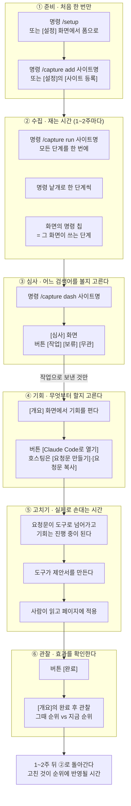
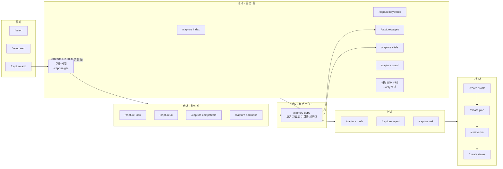
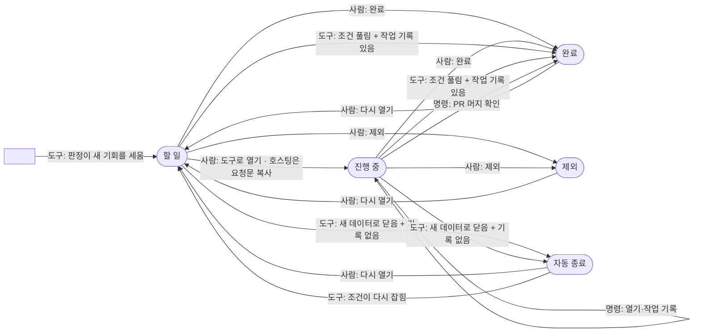
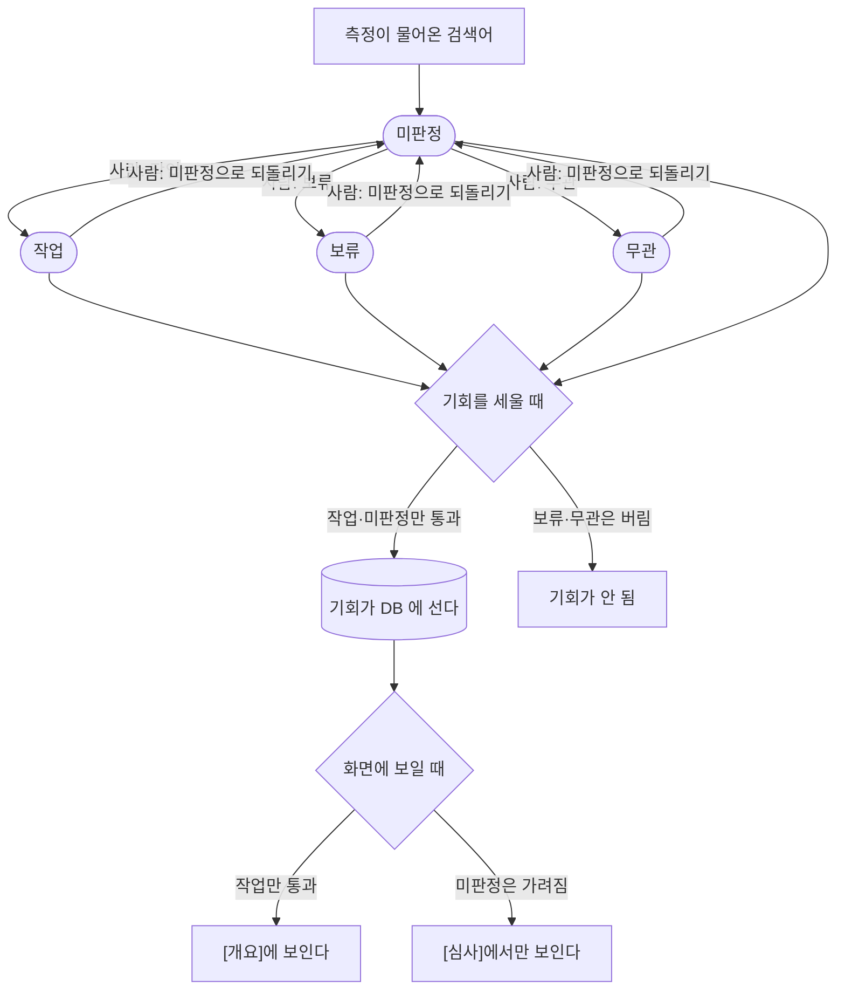
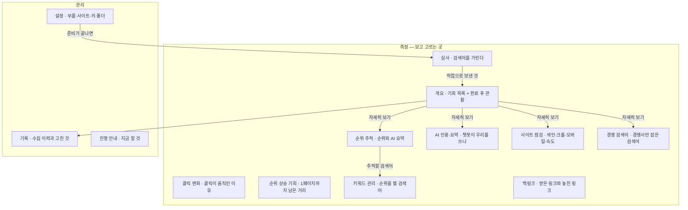

# 사용 안내

설치는 [README](../README.md#설치) 에 있습니다. 여기는 설치한 뒤 **한 바퀴를 어떻게 도는지**,
**어느 화면에서 무엇을 누르는지**를 그림과 표로 봅니다. 화면 한 장을 깊이 보려면
[화면별 문서](screens/), 명령 하나하나는 [README 의 명령 표](../README.md#명령)입니다.

사용자가 하는 일은 **명령**과 **화면 버튼** 둘뿐입니다. 아래 그림 다섯이 그 뼈대이고,
빠짐없는 목록은 [화면별 행동](#화면별-행동-전수)에 있습니다.

## 그림 1 — 한 바퀴: 어느 시간에 무엇을 하나



**③이 ④의 문입니다.** 심사에서 `작업`으로 보내지 않은 검색어의 기회는 [개요]에
아예 안 뜹니다 — 없는 게 아니라 **가려진** 것입니다.

## 그림 2 — 명령: 무엇이 무엇을 필요로 하나



- **`/capture run` 은 위 단계들을 묶음으로 한 번에 돌립니다.** 묶음(메뉴의 제목 = 한 번에
  다시 재는 단위)끼리는 동시에 돌고, 순서가 필요한 단계만 앞 단계를 기다립니다. 묶음의
  정본은 `skills/capture/scripts/run_all.py` 의 `GROUPS`(순서는 `AFTER`), 단계 이름의
  정본은 `STAGES` 입니다. 묶음 몇 개만은 `--groups`, 단계 몇 개만은 `--only` / `--skip`.
- **한 단계가 넘어져도 나머지는 끝까지 갑니다.** 기다리던 뒤 단계는 지난 데이터로 돕니다.
  `--only` 로 고른 순차 실행만 예전처럼 `gsc` 실패에서 멈추고 남은 단계를 `안 돎` 으로
  찍습니다.
- **키가 없으면 유료 단계는 사유를 적고 건너뜁니다** — 실패가 아닙니다. DataForSEO
  잔액이 $1 미만이면 무료 확인 두 번으로 미리 막습니다.
- **`--only` 는 의존을 대신 채워 주지 않습니다.** `--only gaps` 는 재료가 없어도 그냥
  돌고 기회 0건으로 끝납니다.
- **요청문의 「진단」절을 채우는 것은 `/capture pages` 와 `/capture vitals` 입니다.**
  이 둘이 안 돌면 그 절이 통째로 비고 처방이 일반론에 머뭅니다.

## 그림 3 — 기회의 일생: 누가 상태를 바꾸나



- **`자동 종료` 는 사람이 만들 수 없습니다.** 도구만 쓰고, 조건이 다시 잡히면 도구가
  되엽니다. `완료`와 갈라 두는 이유는 완료 후 관찰이 **우리가 고친 효과**만 재야 하기
  때문입니다.
- **닫히는 길이 다섯**입니다: 사람이 [완료] · 사람이 [제외] ·
  `createdb sync` 가 PR 머지를 확인 · 자동 해소인데 작업 기록이 **있으면** 완료 ·
  **없으면** 자동 종료.
- **도구가 닫은 것에는 왜 닫았는지가 붙습니다** — 해결됨 · 중복 합침 · 기준 바뀌어
  정리 · 판단 중단. 좋아진 것은 첫째뿐입니다(자세한 것은 [기회 카드](screens/opportunity-card.md)).
- **버튼 이름은 그 버튼이 만드는 상태 이름**입니다 — [완료] [제외] [다시 열기].
  시작만 찍는 버튼은 따로 없고, 도구에 넘기는 것이 곧 시작입니다 —
  로컬은 [(도구)로 열기], 호스팅은 할 일인 기회에서 [요청문 복사]가 그 기회를
  진행 중으로 옮깁니다. 이미 진행 중이면 다음 한 걸음은 [완료]입니다.
- **[제외] 는 펼친 패널에만** 있습니다. 접힌 줄에는 다음 한 걸음만 섭니다.
- **[다시 열기] 는 두 자리**에 있습니다 — 목록, 그리고 완료 후 관찰에서 순위가 안 오른 줄.
- **묶인 줄의 버튼은 묶인 기회 전부**에 먹습니다.

## 그림 4 — 심사: 검색어를 가리는 다른 축



- **게이트가 둘**입니다. 세울 때는 `보류`·`무관`만 버리고, 보일 때는 `작업`이어야
  통과합니다. 그래서 **미판정 기회는 DB 에 있지만 [개요]에는 안 뜹니다.**
- **심사를 거치는 것은 검색어가 대상인 종류뿐**입니다. 주소·도메인·주제가 대상인
  종류는 심사 없이 바로 섭니다 — 종류 목록의 정본은 `scoring.py` 의 `ALL_KINDS` 와
  `KEYWORD_KINDS` 입니다.
- **`무관` 은 키워드 추적까지 끕니다**(`보류` 는 안 끕니다). 되돌리거나 다른 판정으로
  갈아타면 **그때 꺼진 추적만** 다시 켜집니다 — 애초에 후보였던 줄이나 사람이 직접 끈
  줄은 안 건드립니다.
- 심사는 **정규화한 검색어**에 붙습니다 — 기회 하나가 아니라 그 말 전체입니다.

## 그림 5 — 화면 지도



첫 화면은 상태가 정합니다 — 준비물이 덜 됐으면 **설정**, 한 바퀴도 안 돌았으면
**진행 안내**, 미판정 검색어가 있으면 **심사**로 알아서 열립니다.

## `/capture run` 이 하는 일

한 번 등록해 두면 이후에는 `/capture run {사이트}` 한 줄이 전부입니다. 스크립트가
묶음(정본 `skills/capture/scripts/run_all.py` 의 `GROUPS`)을 동시에 돌리고, 단계 목록의
정본은 `STAGES` 하나입니다. `gsc` 가 실패해도 멈추지 않고 뒤 단계가 지난 데이터로 돕니다 —
구글이 연결되지 않았으면 로그인 안내와 함께 **인증 없이 지금 되는 것**(`/capture keywords`)을
같이 알려 주므로 빈손으로 끝나지 않습니다.
다른 단계도 하나가 실패해도 나머지가 계속 갑니다. 돈이 나가는 축(정본은 `run_all.py`
`STAGES` 의 `is_paid`)은 키가 없으면 알아서 빠지고, 끝날 때 단계별 `완료 / 건너뜀 / 실패` 표 · 리포트 파일
경로 · **손댈 것 1순위와 `/create plan`** · 다음 바퀴 시점을 알려 줍니다.
(플러그인에는 정기 자동 실행이 없습니다 — 1~2주 뒤 같은 명령을 한 번 더 칩니다. 알아서 주기적으로 재게 하려면 아래 「웹에서 이어 하기」.)

- **`/capture run` 은 한 명령이 아니라 묶음들입니다.** 여러 수집·분석 단계를 묶음으로
  동시에 돌립니다. 하나가 실패해도 나머지는 계속 가고, 유료 키가 없는 단계는 알아서
  빠집니다. 묶음 몇 개만은 `--groups`, 단계 몇 개만은 `--only gsc,gaps` 나
  `--skip index,ai` 로 고릅니다. 묶음의 정본은 `skills/capture/scripts/run_all.py` 의
  `GROUPS`, 단계 이름·개수의 정본은 `STAGES` 하나입니다 — 여기에 옮겨 적지 않습니다.
- **대시보드에서는** 화면마다 맨 위의 [이 묶음 다시 재기], 전체는 [진행 안내]의 [전체 다시
  재기]가 같은 일을 합니다. 도는 중에 누르면 대기열에 올라 이어서 돕니다.

## 화면별 행동 전수

화면 하나를 깊이 보려면 **[화면별 문서](screens/)** 로 가세요 — 화면마다 한 장씩,
할 수 있는 것·얻는 것·유즈케이스·비어 보일 때가 들어 있습니다. 아래 표는 한눈에 보는 요약입니다.

그림에 다 못 담은 것까지 여기 있습니다. **로컬 전용**은 박제본(`/capture report`)과
호스팅 화면에는 없습니다.

| 어디 | 할 수 있는 것 |
|---|---|
| **어느 화면에서나** | 왼쪽 레일로 화면 바꾸기 · 보는 사이트 고르기 · **구글 실적 기준일** 고르기(구글 실적 축만 과거로) · [새로고침] · 표 머리글로 정렬 · `i` 힌트 · 인쇄(접힌 것이 다 펴짐) · 준비 배너의 명령 칩 복사·이동 링크·[자세히]·[다시 시도] |
| **심사** | [작업] [보류] [무관] [미판정으로 되돌리기] · 판정·종류 거르개 · 검색 · 체크박스/행 클릭/`스페이스`로 고르기 · 키보드 `j` `k` `1` `2` `3` · [맨 위로] [조건 지우기] [개요] |
| **기회가 붙은 모든 화면** | 줄 펼치기 · [완료] [다시 열기] · (펼친 패널에만) [제외] · **[Claude Code로 열기]**(로컬 전용 — 기회를 진행 중으로 옮김, 도구를 안 골랐으면 [설정에서 고르기]) · [요청문 만들기] → [요청문 복사](호스팅 전용 — 할 일이면 진행 중으로 옮김) · 고칠 페이지 링크 열기 · [(화면) 화면에서 자세히 보기 →] |
| **개요** | 상태 거르개 · 종류 칩 · 검색 · [CSV 내려받기] · [N건 더 보기] [조건 지우기] [완료·제외 보기] [기회 열기] · 완료 후 관찰의 [다시 열기] |
| **클릭 변화** | 행 펼치기 · [검색어 열기] · [CSV 내려받기] |
| **순위 상승 기회** | 정렬·구간 거르개 · 검색 · 방향 거르개 · 깊이 그림의 레인 클릭 · [그 줄 열기] [검색어 열기] [전체 보기] · [키워드 관리] · [CSV 내려받기] ×2 |
| **키워드 관리** | 시장 탭 · 추적 중/후보 탭 · 검색 · 체크 → [추적에 넣기] [추적에서 빼기] [시장 옮기기…] · [키워드 찾기] · 씨앗 키워드 칸(벗어나면 저장) |
| **순위 추적** | 지층 칩 · AI 요약 거르개 · AI 요약 공백 칩 · 검색 · 행 펼치기 · [문턱 N개 보기] 류 · [키워드 관리 열기] · [순위 제공자 연결](로컬 전용) · [CSV 내려받기] [조건 지우기] |
| **AI 인용·요약** | 상태 칩 · 카테고리·엔진 거르개 · 검색 · 질문 펼치기 · 엔진 카드·교차 칸 클릭 · [질문 열기] [질문 만들기] [순위 상승 기회 열기] · [CSV 내려받기] [조건 지우기] |
| **사이트 점검** | 섹션 배지로 점프 · 색인 갈래 칩 · 크롤 갈래 칩 · 검색 ×2 · 행 펼치기 · [N건 더 보기] · [CSV 내려받기] ×7 |
| **백링크** | 행·카드 펼치기 · [도메인 열기] · [링크처 열기] [되찾을 링크 보기] [잃은 도메인 보기] · [CSV 내려받기] ×2 |
| **경쟁 검색어** | 갈래 칩 · 카드 펼치기 · [검색어 열기] [키워드 관리 열기] · [경쟁사 등록](로컬 전용) · [CSV 내려받기] [조건 지우기] |
| **기록** | 종류 칩 · 검색 ×2 · 결과·병합 거르개 · 실패한 실행 재실행 칩 · [← 기회 대상](개요의 그 카드로) · [병합 전만 보기] [기회 열기] · PR 링크 · [CSV 내려받기] ×2 |
| **진행 안내** | [지금 할 것] 단계 칩 복사 · 접힌 설명 펴기 |
| **설정**(전부 로컬 전용) | 측정을 맡는 곳·기회를 열 도구·터미널 라디오(고르는 즉시 저장) · 사이트별 로컬 폴더 [저장] · [설치]/[다시 설치] · [사이트 등록] · [구글 로그인] [인증 파일 열기] [수집 부품 설치] [클라이언트 저장] · [키 저장] · [스킬 설치] · [링크 만들기] → [웹에서 등록] · [연결](웹에서 이어 하기) |

- **명령 칩은 전부 누르면 복사**됩니다(로컬). 붙여 넣는 곳은 채팅입니다.
- **CSV 는 지금 걸러 놓은 목록 그대로** 받습니다. 박제본에 남는 유일한 행동 계열입니다.
- **`/api/creation`** 은 화면에 버튼이 없습니다 — 개발 도구가 `createdb.py` 로 남기는
  창구이고, 그 기록이 [기록]의 「고친 것」과 기회 줄의 `적용 N건` 배지로 돌아옵니다.
- **고치는 일은 대시보드에서 시작합니다.** 기회를 눌러 여는 버튼이 요청문을 파일로
  써서 개발 도구를 띄웁니다 — 그 버튼이 그 기회를 '진행 중'으로 옮깁니다(호스팅은
  [요청문 복사]가 같은 일을 합니다). [완료]는 고친 결과를 몇 주 지켜본 뒤 사람이 누릅니다.
- **막히면 `/setup`** 으로 돌아갑니다. 무엇이 빠졌는지와 다음 한 걸음 하나를 말해 줍니다.

## 대시보드

`/capture dash <사이트>` — 127.0.0.1 전용 로컬 웹 UI (파이썬 표준 라이브러리만,
빌드 도구·CDN 없음).

- **1페이지까지 남은 거리** — 순위를 깊이로 그립니다. 1페이지 영역을 깔고 10위에
  경계선을 그은 뒤, 2페이지 검색어는 **경계까지 되밀어야 할 거리**를 막대로 보여줍니다.
- **심사** — 측정이 물어온 검색어를 무관·보류·작업으로 먼저 가립니다. 띄어쓰기만
  다른 변형은 한 줄로 묶이고, 한 번 가린 검색어는 다음 측정에서 다시 안 올라옵니다.
  여러 줄을 골라 한 번에, 키보드 `j`/`k`·`1`/`2`/`3`으로도 됩니다.
- **다음에 손댈 것** — 작업으로 보낸 검색어의 기회를 할 일 → 진행 중 → 완료로 그
  자리에서 옮기고(클릭 즉시 저장), 완료한 것은 그때와 지금 순위를 나란히 봅니다
- **날짜별 추이** — 클릭·노출을 하루 단위로. 기간 합계만 있을 때는 "언제부터"를
  물어볼 수 없었습니다 (구글이 값을 확정할 때까지 기다리므로 **최근 3일은 비어 있습니다**)
- **모바일이 밀리는 검색어** — 같은 검색어의 모바일 vs 데스크톱 평균 순위 차
- **색인이 막힌 URL** — robots·크롤 실패·canonical 불일치·미색인 네 갈래로 분류
- **움직인 검색어 · 순위 기록 · AI 인용 현황 · 수집 이력**
- 라이트/다크, 모바일 대응, 외부 요청 0

리포트는 같은 화면의 **박제본**입니다:

```
/capture report <사이트>
```

그 시점 데이터를 페이지 안에 박아 넣은 자립형 HTML을 `~/.capture/reports/`에
남깁니다. 서버도 인터넷도 필요 없고 남한테 보내도 그대로 열립니다. 손댈 수 없는
기록이라 트리아지 버튼과 설정 패널은 빠집니다.

## 웹에서 이어 하기

같은 사이트를 **알아서 주기적으로 재게** 하고 싶으면 호스팅판으로 넘길 수 있습니다.
대시보드 **[설정] → 6. 웹에서 이어 하기**에서 링크를 만들어 열면, 구글 로그인 한
번으로 여기 적어 둔 설정 그대로(도메인·종류·씨앗 키워드·브랜드 표기·경쟁사) 등록
됩니다 — API 키는 서버가 대므로 다시 넣지 않습니다.

측정한 자료는 넘어가지 않습니다(웹이 자기 계정에서 처음부터 다시 잽니다). 로컬에
있던 것은 그대로 남고, 두 곳을 같이 써도 됩니다 — 웹은 주기 측정을, 플러그인은
해석과 판단이 필요한 작업을 맡습니다. 기회를 실제로 고치는 일은 이 PC 의 개발
도구가 엽니다(웹 화면은 브라우저라 PC 의 프로세스를 못 띄웁니다).

주소를 바꾸려면 `SEOMINER_HOSTED_URL` 환경 변수를 세우면 됩니다 (기본값의 정본은
`skills/capture/scripts/dashboard.py` 의 `HOSTED_URL`).
