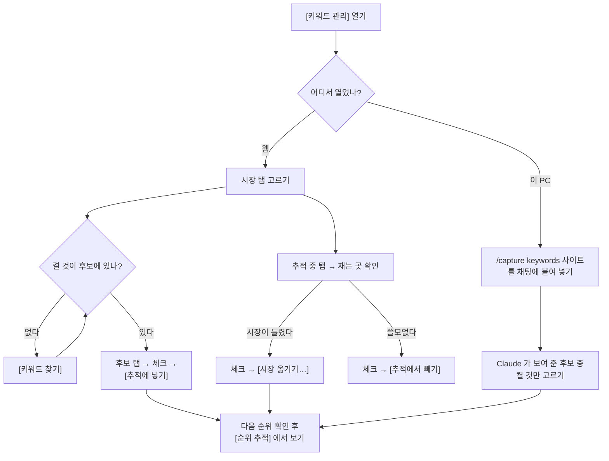

# [키워드 관리] — 어떤 검색어의 순위를 잴지(추적)를 시장(나라 구글)마다 정하는 화면

화면 머리의 한 줄은 늘 이렇게 말합니다: **"어떤 검색어의 순위를 잴지 정합니다."**

켠 검색어만 순위를 잽니다 — [순위 추적] 화면의 줄과 제공자 조회 비용이 이 목록에서 나옵니다.
2026-10-16 까지는 [키워드] 화면 맨 아래의 [추적할 검색어] 섹션이었고, 지금은 메뉴에서
[키워드] 바로 아래에 따로 섭니다. [키워드] 화면에는 이리로 오는 이음 한 줄만 남았습니다.

배포마다 이 화면의 몸이 다릅니다.

- **웹(호스팅)** — [추적할 검색어] 편집기 하나입니다. 여기서 바로 켜고 끄고 시장을 옮깁니다.
- **이 PC 의 대시보드(로컬)** — 편집기가 없습니다. 켜고 끄는 일을 받는 서버 쪽 길(`/api/keywords`)이
  호스팅에만 있어서입니다. 대신 **지금 추적 중인 수**와, 채팅에서 고르는 명령
  (`/capture keywords <사이트>`)이 섭니다. 메뉴에서 숨기지 않은 이유는 로컬에서도 추적 목록을
  바꾸기 때문입니다 — 그 길이 화면이 아니라 채팅일 뿐입니다.
- **박제본(저장해 둔 보고서 파일)** — 이 화면이 없습니다. 바꿀 수 없는 기록에 관리 화면을 남기지
  않습니다([설정]·[심사]가 빠지는 것과 같은 이유).

---

## 여기서 할 수 있는 것

| 할 일 | 어떻게 | 무엇이 바뀌나 |
| --- | --- | --- |
| 시장 하나만 본다 *(웹)* | 위의 **시장 탭**(예: `미국 구글 · 영어 · 100/100`)을 누른다. 다시 누르면 전체로 돌아온다. 시장이 하나뿐이면 탭 대신 그 시장 한 칸만 선다 | 아래 목록·상태 탭 숫자가 그 시장 것만 남는다. 탭마다 그 나라 구글과 추적 수/그 시장 한도가 서고, 0이거나 한도를 넘은 시장, 사이트 시장에서 빠진 곳(`시장 밖`)은 경고색이다 |
| 추적 중인 것과 후보를 오간다 *(웹)* | **추적 중 / 후보** 탭 | 목록이 그 상태의 검색어로 바뀐다. 후보 탭의 숫자는 후보 수 — 시장마다 노출 순 상위 200개까지 받아, 넘으면 `200+` |
| 검색어로 찾는다 *(웹)* | **검색어로 찾기** 칸 | 지금 탭·시장 안에서 그 글자가 든 줄만 남는다(대소문자 무시) |
| 추적을 켜고 끈다 *(웹)* | 줄을 체크 → 아래 **[추적에 넣기]**(후보 탭) / **[추적에서 빼기]**(추적 중 탭) | 켠 검색어만 그 시장 나라의 구글에서 순위를 잰다. 고른 것이 없으면 버튼이 잠긴다. 한도는 시장(나라 구글)마다 따로다 — 시장 하나에 서버 설정 `SEOMINER_MAX_KEYWORDS`(기본 100)개, 시장이 늘면 사이트 전체 한도도 시장 수만큼 는다. 한도를 넘은 시장은 다음 수집 때 자동으로 켜진 검색어부터 노출이 적은 순으로 꺼지고, 사람이 켠 것·씨앗·진행 중인 기회의 검색어는 그대로 둔다. **여기서 사람이 손대면 [심사]의 「무관」이 껐다는 표식이 지워진다** — 그 뒤로는 그 검색어의 무관 판정을 되돌려도 자동으로 다시 켜지지 않는다(지금 상태를 정한 것이 사람이기 때문이다) |
| 검색어의 시장을 바로잡는다 *(웹)* | 체크 → 아래 **[시장 옮기기…]** 에서 시장 고르기 | 그 검색어를 고른 시장 나라의 구글에서 잰다(예전 시장으로 잰 순위는 따로 옮겨 둔다). 시장은 보통 글자 언어와 검색한 나라로 자동으로 정해진다 — 글자 언어의 시장이 없으면 노출이 가장 많은 나라의 시장(한자만 쓴 일본 검색어 → 일본 구글). 사람이 옮긴 것은 줄에 `시장 직접 정함`이 붙고 자동 판정이 다시 덮지 않는다. 켜진 검색어는 옮길 시장의 한도 안에서만 옮겨진다 |
| 한도까지 얼마나 찼는지 본다 *(웹)* | 아래 줄 끝의 `추적 중 N / M개`와 진행 막대 | 막대는 그 글자의 N/M 을 그린다. 한도에 닿으면 경고색이다 |
| 후보를 더 캔다 | 후보가 비었을 때 빈 상태의 **[키워드 찾기]**, 또는 화면 머리의 **[단계별로 다시]** 안의 키워드 찾기 | 웹에서는 그 단계가 바로 돈다(로컬은 명령이 복사된다). 자동완성·서치콘솔에서 새 후보를 모은다 |
| 추적을 바꾼다 *(로컬)* | **`/capture keywords <사이트>`** 칩을 눌러 복사 → 채팅에 붙여 넣기 | Claude 가 후보를 관련성으로 걸러 보여 주고, 사용자가 고른 것만 추적에 넣는다 |
| 켠 검색어의 지금 순위를 본다 | 로컬 안내 문장의 **[순위 추적]** | [순위 추적] 화면으로 간다 |

---

## 여기서 얻는 것

### 읽는 정보 (웹)

목록은 한 줄이 검색어 하나입니다. 열은 다섯입니다(좁은 화면에서는 둘째·셋째 줄로 접힙니다).

- **검색어** — 그 아래 작은 글씨로 어디서 왔는지(서치콘솔 · 자동완성 · 씨앗 · 검색결과 연관 ·
  경쟁사 검색어 · 순위 검색어 · Claude 제안 · 직접). 사람이 시장을 옮겼으면 `시장 직접 정함`
- **재는 곳** — 예: `일본 구글`. 같은 나라 시장이 둘이면 언어를 붙인다(`한국 구글(영어)`)
- **지금 순위** — 그 시장으로 잰 마지막 직접 조회. `4위`·`순위 밖`·`안 잼`과 그 날짜
- **서치콘솔 노출** — 노출과 노출이 난 나라 상위 둘(예: `노출 455 · 필리핀 112, 미국 83`).
  노출이 없으면 월 검색량과 난이도, 그것도 없으면 비운다

`site:` 같은 연산자 검색은 후보에 올리지 않습니다.

### 읽는 정보 (로컬)

- 부제: `지금 N개를 추적합니다. 켠 검색어만 순위를 잽니다.` / 없으면 `아직 추적 중인 검색어가 없습니다.`
- 채팅에서 칠 명령 칩 하나(`/capture keywords <사이트>`)

### 나가는 것

이 화면은 파일을 내보내지 않습니다. 추적 목록을 바꾸면 다음 순위 확인부터 그 목록으로 잽니다.

---

## 언제 쓰나 — 유즈케이스

**1. 새 시장(예: 일본)을 열었는데 그 나라에서 재는 검색어가 0개다**

시장 탭의 `일본 구글`이 경고색 `0/100` 입니다. 그 탭을 누르고 **후보** 탭으로 가 관련 있는 것만
체크 → [추적에 넣기]. 후보가 비었으면 [키워드 찾기]로 먼저 캡니다.

**2. 영어 검색어가 한국 구글에서 재지고 있다**

**추적 중** 탭에서 그 줄들의 [재는 곳]을 보고, 잘못 붙은 것을 체크 → [시장 옮기기…]에서 맞는
시장을 고릅니다. 옮긴 줄에는 `시장 직접 정함`이 붙어 다음 수집이 되돌리지 않습니다.

**3. 순위 조회 비용을 줄이고 싶다**

**추적 중** 탭에서 노출이 없고 순위도 `순위 밖`인 줄을 골라 [추적에서 빼기]. 막대와
`추적 중 N / M개`가 줄어든 만큼 다음 조회 비용이 줍니다.

**4. 이 PC 에서만 쓴다(로컬)**

명령 칩 `/capture keywords <사이트>` 를 복사해 채팅에 붙입니다. Claude 가 후보를 보여 주면 켤
것만 고릅니다. 결과는 [순위 추적]에서 봅니다.

---

## 이 화면이 비어 보일 때

**이 PC 의 대시보드에서 목록이 안 나온다**

정상입니다. 로컬에는 편집기가 없습니다 — 추적 수와 채팅 명령만 섭니다. 목록을 보며 고르려면 웹
대시보드에서 엽니다.

**`검색어 목록을 못 읽었습니다`** *(웹)*

서버에서 목록을 못 받았습니다. 탭·버튼도 같이 물러납니다(누를 대상이 없어서). 다시 시도하면 받아 옵니다.

**`…후보가 없습니다`** *(웹)*

아직 후보를 안 캤거나, 고른 시장에 후보가 없습니다. **[키워드 찾기]** 를 돌리면 검색창 자동완성과
서치콘솔에서 모은 검색어가 후보로 들어옵니다.

**`…추적 중인 검색어가 없습니다`** *(웹)*

그 시장에서 켠 검색어가 없습니다. **[후보에서 고르기]** 가 후보 탭으로 옮겨 줍니다.

**`맞는 검색어가 없습니다`** *(웹)*

검색어로 찾기 칸 때문입니다. 칸을 비우면 돌아옵니다.

**보고서 파일에 이 화면이 없다**

박제본은 이 화면을 뺍니다. [키워드] 화면의 이음 한 줄도 같이 빠집니다.

<!-- 근거:
  skills/capture/templates/views/kwmanage.html — view-def(id·group·sub·sections·stages), 로컬 안내(#kwm-here:
    d.kw_active, window.act("keywords"), go("rank")), 편집기가 붙으면 안내를 숨김($("sm-kw")),
    KM_wireTrack(.cnt 의 「N / M」 → .kwprog)
  skills/capture/templates/sections/sm-kw.html — section-def(view kwmanage, after kwm-here, only hosted),
    시장 탭·상태 탭·찾기·[추적에서 빼기]·[시장 옮기기…]·.cnt·.kwprog 마크업, 넓은 화면 목록 높이
  server/assets/dash.html — kwLoad()/kwPaint()/kwBar()/kwPost()(시장 탭·줄·빈 상태 문구·KW_SRC 출처 이름),
    keywords()(이벤트), retry("kw")
  skills/capture/templates/dashboard.html — SM.drop("kwmanage")(박제본), NAV_ICON.kwmanage, go()
  skills/capture/scripts/dashboard.py — VIEW_ORDER, _assemble()(section-def 끼우기), gather 의 kw_active
  skills/capture/scripts/run_all.py — GROUPS search 의 views
  skills/capture/scripts/db.py — list_keywords(지금 순위 rank·rank_at, 후보는 시장마다 per_market),
    is_operator_query, move_keywords_market, set_keywords_active(사람이 손대면 verdict_off=0), count_active_keywords
  skills/capture/SKILL.md — /capture keywords 2번(후보 큐레이션 → 승인분만 is_active=1)
-->
